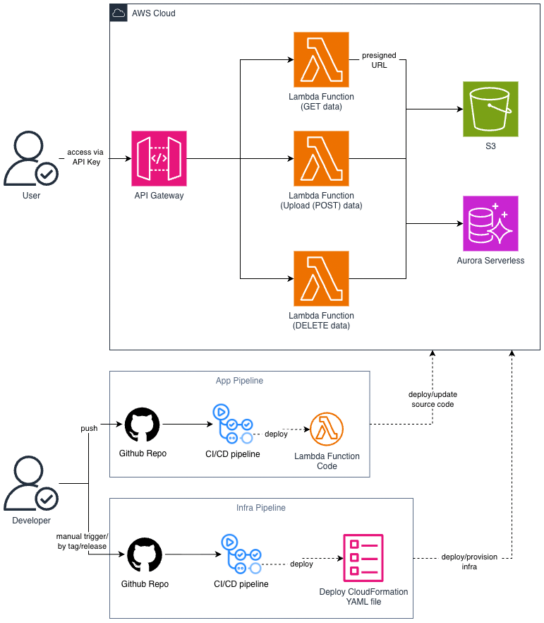

# Serverless File API — CI/CD

|            |             |
| ---------- | ----------- |
| Duration   | 3 hours     |
| Difficulty | Easy–Medium |
| Platform   | AWS         |
| Focus      | CI/CD       |

## 1. Project Description

### 1.1. Background

The application is a serverless image file API. It stores JPEG and PNG files in Amazon S3 and file
metadata in Aurora PostgreSQL, and it returns a presigned S3 URL for every file it reports. Three
AWS Lambda functions implement the API: `list` returns all files or one file, `upload` stores a new
file, `delete` removes a file. Amazon API Gateway exposes the functions through an HTTP API protected
by an API key. The functions call the database through the RDS Data API, so the stack needs no VPC.

The application code, the SQL schema and the migration script are complete and must not be changed.
What is missing is the platform around them. `infra/stack.yaml` declares every resource, but some
configuration blocks are absent and some values are placeholders. `.github/workflows/infra.yml` and
`.github/workflows/app.yml` declare the pipeline steps, but some values and one shell step are
absent. As a Cloud Engineer, your job is to complete those three files so that one pipeline
provisions the stack and migrates the database, and the other pipeline deploys the application code.

### 1.2. Task

1. Read this document, `README.md`, `infra/stack.yaml`, `.github/workflows/infra.yml` and
   `.github/workflows/app.yml`.
2. Log in to the AWS Academy Lab console and open the AWS details page with the lab credentials.
3. Add the repository secrets listed in section 4.1.
4. Complete the missing configuration in `infra/stack.yaml`.
5. Complete the missing configuration in `.github/workflows/infra.yml`.
6. Complete the missing configuration in `.github/workflows/app.yml`.
7. Push a `release/v*` tag to run the infrastructure pipeline.
8. Push a commit to `main` to run the application pipeline.
9. Verify the pipeline runs, the stack outputs and the API as described in section 6.

### 1.3. Technical Details

1. Default region: N. Virginia (`us-east-1`). Both workflows already set it.
2. Service prefix: `workshop-api`. Resource names derive from the `ProjectName` parameter.
3. Images bucket name: `workshop-api-images-<your-name>-2026`. S3 bucket names are globally unique
   across all AWS accounts, so include your own name and pick another one if the name is taken.
4. Lambda runtime: Node.js 22 (`nodejs22.x`).
5. All services that need an IAM role use the `LabRole` role. Its ARN is a stack parameter and is
   read from the `LAMBDA_ROLE_ARN` secret.
6. Do not change application code: `src/`, `schema.sql` and the migration script are read-only.

### 1.4. References

1. CloudFormation template anatomy: https://docs.aws.amazon.com/AWSCloudFormation/latest/UserGuide/template-anatomy.html
2. AWS Lambda developer guide: https://docs.aws.amazon.com/lambda/latest/dg/welcome.html
3. S3 presigned URLs: https://docs.aws.amazon.com/AmazonS3/latest/userguide/using-presigned-url.html
4. API Gateway HTTP API: https://docs.aws.amazon.com/apigateway/latest/developerguide/http-api.html
5. API keys and usage plans: https://docs.aws.amazon.com/apigateway/latest/developerguide/api-gateway-api-usage-plans.html
6. RDS Data API: https://docs.aws.amazon.com/AmazonRDS/latest/AuroraUserGuide/data-api.html
7. Aurora Serverless v2: https://docs.aws.amazon.com/AmazonRDS/latest/AuroraUserGuide/aurora-serverless-v2.html
8. GitHub Actions documentation: https://docs.github.com/en/actions
9. aws-actions/configure-aws-credentials: https://github.com/aws-actions/configure-aws-credentials

## 2. Architecture



A client sends a request with the `x-api-key` header to the HTTP API. API Gateway matches one of the
four routes and invokes the matching Lambda. The `list` function reads file metadata from Aurora
PostgreSQL through the Data API and signs a GET URL for each S3 object. The `upload` function
validates the declared image type and size, writes the object to the images bucket and inserts the
metadata row. The `delete` function removes the row and the object. The functions receive the bucket
name, the cluster ARN, the secret ARN and the database name as environment variables, and they read
the database credentials from Secrets Manager through the Data API.

Two pipelines automate the delivery. The infrastructure pipeline deploys `infra/stack.yaml` with
CloudFormation and then applies `schema.sql` from the runner, using the stack outputs for the
migration. The application pipeline packages `src/` and updates the code of the three functions,
which replaces the placeholder code that the stack installs.

## 3. Service Requirements

The application code is frozen, so the deployed services must match the contract it expects.

### 3.1. S3 Bucket

The images bucket is private. Objects are encrypted at rest with server-side encryption, and all
four public access blocks are enabled so that no policy or ACL can expose the bucket. The bucket
name comes from the `ImagesBucketName` parameter. The application writes objects under the
`images/` prefix and only reads them through presigned URLs. Uploads are capped at 4 MB of decoded
image data.

### 3.2. Secrets Manager Secret

The stack already creates the secret and stores a JSON object with the keys `username` and
`password`. The Data API reads the secret to authenticate. The username is the `DbUsername`
parameter, the password is the `DbPassword` parameter, which is supplied by the pipeline from a
repository secret.

### 3.3. Aurora PostgreSQL

The database is an Aurora PostgreSQL cluster in Serverless v2 mode, so its capacity is measured in
ACU and must scale between 0 and 2 ACU. The Data API must be enabled on the cluster, otherwise the
functions cannot connect. The cluster runs one instance of the `db.serverless` instance class. The
database name is `appdb` and the master username is `appuser`. The `files` table is created by the
migration script, not by the stack.

### 3.4. Lambda Functions

Three functions: `workshop-api-list`, `workshop-api-upload`, `workshop-api-delete`. All use runtime
`nodejs22.x`, handlers `handlers/list.handler`, `handlers/upload.handler` and
`handlers/delete.handler`, 256 MB of memory, a 29 second timeout and the `LabRole` execution role.
Each function receives four environment variables: `IMAGES_BUCKET`, `DB_CLUSTER_ARN`, `DB_SECRET_ARN`
and `DB_NAME`.

### 3.5. HTTP API

The API is an API Gateway HTTP API with four routes:

| Method | Path          | Lambda   |
| ------ | ------------- | -------- |
| GET    | `/files`      | list     |
| GET    | `/files/{id}` | list     |
| POST   | `/files`      | upload   |
| DELETE | `/files/{id}` | delete   |

Each route is integrated with API Gateway as a proxy integration with payload format version 2.0 and
no authorization. The API is deployed to the `$default` stage with automatic deployment, so the base
URL carries no stage path.

CORS is configured on the API itself. The allowed origin is the `AllowedOrigins` value supplied by
the pipeline. Use `*` unless a specific web client connects: the checks in section 6.3 send
`Origin: http://example.com` and must match it. The allowed headers are `content-type` and
`x-api-key`. The allowed methods are GET, POST, DELETE and OPTIONS.

### 3.6. API Key and Usage Plan

Every one of the four routes requires an API key, so a request without the `x-api-key` header is
rejected by API Gateway before the Lambda runs. The API key resource is enabled. A usage plan binds
the API and its `$default` stage, defines a burst limit and a rate limit, and the API key is attached
to that usage plan. Both limits are your choice.

### 3.7. Stack Outputs

The template already declares the outputs `ApiUrl`, `ImagesBucketName`, `DbClusterArn`,
`DbSecretArn` and `ApiKeyId`. The infrastructure pipeline reads them after the deployment.

## 4. Pipeline Requirements

### 4.1. Repository Secrets

Add these secrets to the repository:

1. `AWS_ACCESS_KEY_ID`
2. `AWS_SECRET_ACCESS_KEY`
3. `AWS_SESSION_TOKEN`
4. `LAMBDA_ROLE_ARN`
5. `DB_PASSWORD`

The first four values come from the AWS Academy Lab. Lab credentials are temporary: they stop
working when the lab session ends, so update `AWS_ACCESS_KEY_ID`, `AWS_SECRET_ACCESS_KEY` and
`AWS_SESSION_TOKEN` at the start of every session. `LAMBDA_ROLE_ARN` is the ARN of `LabRole`, copied
from the IAM console. `DB_PASSWORD` is at least 8 characters and uses letters, digits and the
symbols allowed by the template.

### 4.2. Infrastructure Pipeline

`.github/workflows/infra.yml` runs on manual dispatch and on a `release/v*` tag. It provisions
everything: it installs the migration dependency, deploys `infra/stack.yaml` with the stack name,
project name, role ARN, bucket name, database password and allowed origin from the workflow
environment, exports the stack outputs so the next steps can read them, applies the schema, and
prints a summary.

> [!NOTE]
> The infrastructure pipeline only runs on tags like `release/v1.0.0`. Any other tag does nothing.

The Lambda code in the template is a placeholder. A freshly created stack answers every request
with a 500 error until the application pipeline runs.

### 4.3. Application Pipeline

`.github/workflows/app.yml` runs on every push to `main`. It installs the runtime dependencies,
packages the content of `src/` — the handlers, the libraries, the migration script and
`node_modules` — and updates the code of the three functions. The functions keep their
configuration and environment variables; only the code changes.

The pipeline fails until the stack exists, so run the infrastructure pipeline first.

## 5. Rules

1. Edit only `infra/stack.yaml`, `.github/workflows/infra.yml` and `.github/workflows/app.yml`.
2. Every other file is read-only. Changes to `src/`, `schema.sql` or `README.md` are not accepted.
3. Empty the images bucket first, then delete the stack. CloudFormation cannot delete a bucket that
   still holds objects.
4. Use one stack per person, with your own stack name and bucket name.
5. Run the pipelines against the lab account only. Do not point them at another AWS account.

## 6. Testing and Verification

### 6.1. Infrastructure Pipeline

Trigger the pipeline from the Actions tab: select the `infra` workflow and choose Run workflow. The
tag path works the same way:

```sh
git tag release/v1.0.0
git push origin release/v1.0.0
```

In GitHub Actions all steps must be green. In the CloudFormation console the stack reaches
`CREATE_COMPLETE`. The job summary shows `ApiUrl` and `ApiKeyId`. Read the key value with:

```sh
aws apigateway get-api-key --api-key <ApiKeyId> --include-value --query value --output text
```

If the migration step fails, the cluster is not reachable through the Data API or the secret does
not hold valid credentials. Fix the template, empty the bucket, delete the stack and run the pipeline
again:

```sh
aws s3 rm s3://$BUCKET --recursive
aws cloudformation delete-stack --stack-name $STACK
aws cloudformation wait stack-delete-complete --stack-name $STACK
```

A create that fails leaves the stack in `ROLLBACK_COMPLETE`, and `deploy` refuses to update a stack
in that state until you delete it.

### 6.2. Application Pipeline

Push a commit to `main` and open the `app` workflow run. The run must succeed and list three
`update-function-code` calls. In the Lambda console the `Last modified` value of the three functions
must match the run time.

### 6.3. API

The `aws` commands below run in CloudShell or any shell with the lab credentials. Set the two values
from the pipeline:

```sh
API_URL="https://<api-id>.execute-api.us-east-1.amazonaws.com"
API_KEY="<key value>"
```

Upload a PNG file:

```sh
IMAGE=cat.png
DATA=$(base64 "$IMAGE" | tr -d '\n')
curl -s -X POST "$API_URL/files" -H "x-api-key: $API_KEY" -H 'content-type: application/json' \
  -d "{\"name\":\"$IMAGE\",\"contentType\":\"image/png\",\"data\":\"$DATA\"}"
```

Expected: `201` with the fields `id`, `name`, `contentType`, `size`, `createdAt` and `url`. Keep the
`id` and the `url`, then check the rest:

```sh
curl -s "$API_URL/files" -H "x-api-key: $API_KEY"
```
Expected: `200` with `{"files":[...]}` containing the new file.

```sh
curl -s "$API_URL/files/<id>" -H "x-api-key: $API_KEY"
```
Expected: `200` with the file and a new presigned `url`.

```sh
curl -s "<url from the response>" -o out.png
file out.png
```
Expected: `out.png` is a PNG image. The URL expires after 300 seconds; request the file again for a
fresh one.

```sh
curl -s -i -X DELETE "$API_URL/files/<id>" -H "x-api-key: $API_KEY"
```
Expected: `204` with no body, and `GET /files` no longer lists the file.

```sh
curl -s -i -X OPTIONS "$API_URL/files" -H 'Origin: http://example.com' \
  -H 'Access-Control-Request-Method: POST' -H 'Access-Control-Request-Headers: content-type,x-api-key'
```
Expected: `204` with `access-control-allow-origin`, `access-control-allow-methods` and
`access-control-allow-headers`.

```sh
curl -s -i "$API_URL/files"
```
Expected: `403` with `{"message":"Forbidden"}`. A request without the key never reaches a Lambda.

The last check proves the API key requirement. The CORS check proves the origin, header and method
configuration: an API that answers `200` from `curl` but fails the preflight is not usable by a web
client.
